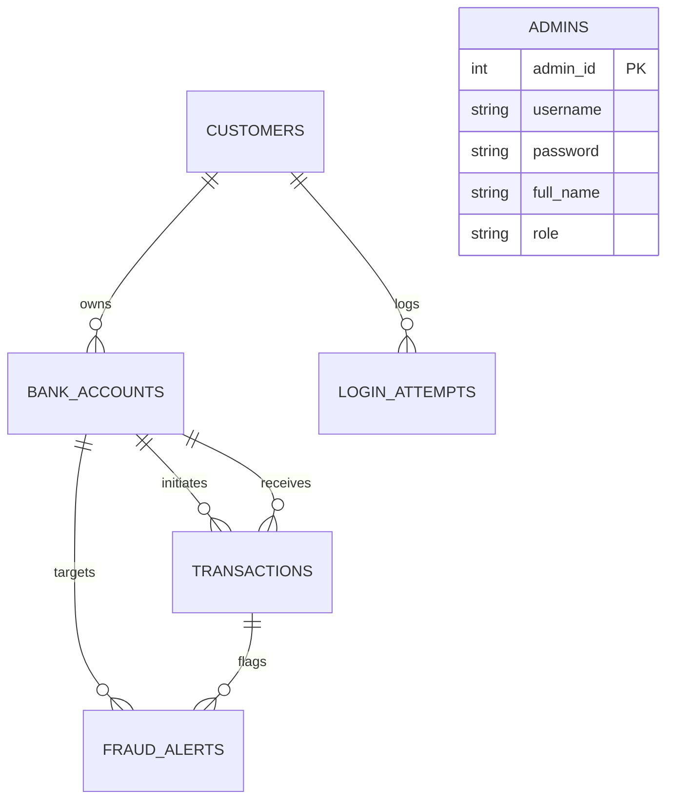

# Project Documentation: Banking Management System with Fraud Detection (ADBMS)

**Project Name:** Apex Financial — Core Banking & Automated Risk Detection Platform  
**Course:** Advanced Database Management Systems (ADBMS)  
**Database:** PostgreSQL (with PL/pgSQL Triggers, Stored Procedures, Functions, & Views)  
**Backend:** Node.js + Express.js  
**Frontend:** HTML5, Modern CSS3 (Stripe Design System), JavaScript, Chart.js, Lucide Icons  

---

## 1. Executive Summary & Purpose

The **Banking Management System with Fraud Detection** is a full-stack banking platform designed to demonstrate advanced database concepts in an enterprise fintech context. 

Traditional applications often rely solely on application-level validations. However, in mission-critical financial systems, risk rules and transactional integrity must reside directly inside the **Database Management System (DBMS)**. This ensures that regardless of whether a transaction originates from the web UI, a mobile application, a backend batch job, or a direct database query, the rules cannot be bypassed.

### Key Objectives:
1. Implement core retail banking operations (deposits, withdrawals, and account-to-account transfers).
2. Enforce strict **ACID properties**, row-level locking, and deadlock prevention at the database layer.
3. Implement an automated, rule-based **Fraud Detection Engine** using database triggers.
4. Support administrative dispute resolution with **compensating transactions (automated fund rollbacks)**.
5. Provide a modern, clean, Stripe-inspired fintech dashboard for both Customers and Bank Risk Administrators.

---

## 2. System Architecture

```
┌─────────────────────────────────────────────────────────────┐
│                 Modern Fintech Web Frontend                 │
│         (Customer Dashboard, Admin Risk Console, Chart.js)   │
└──────────────────────────────┬──────────────────────────────┘
                               │ REST API (JSON / HTTP)
┌──────────────────────────────▼──────────────────────────────┐
│                  Node.js / Express Backend                   │
│   (Auth Controller, Customer Controller, Admin Controller)  │
└──────────────────────────────┬──────────────────────────────┘
                               │ Parameterized SQL / Procedures
┌──────────────────────────────▼──────────────────────────────┐
│                    PostgreSQL Database                      │
│  ┌─────────────────────────┐     ┌───────────────────────┐  │
│  │    Relational Schema    │     │   Stored Procedures   │  │
│  │ (CUSTOMERS, ACCOUNTS,   │     │  (sp_deposit_money,   │  │
│  │  TRANSACTIONS, ALERTS)  │     │   sp_transfer_money)  │  │
│  └────────────┬────────────┘     └───────────┬───────────┘  │
│               │                              │              │
│  ┌────────────▼────────────┐     ┌───────────▼───────────┐  │
│  │    PL/pgSQL Triggers    │     │   Auditing & Views    │  │
│  │  (Fraud Rules 1, 2, 3)  │     │ (vw_customer_history, │  │
│  │                         │     │  ledger_reconcile)    │  │
│  └─────────────────────────┘     └───────────────────────┘  │
└─────────────────────────────────────────────────────────────┘
```

---

## 3. Database Schema & Relational Design

The database consists of **6 normalized relational tables** located in [`database/schema.sql`](file:///c:/Users/aades/Desktop/dbms_project/database/schema.sql):



### Table Definitions:

1. **`CUSTOMERS`**: Stores verified identity and credentials.
   - `customer_id` (PK, Serial)
   - `full_name`, `email` (Unique), `phone`, `username` (Unique), `password`, `address`
   - `status` (`CHECK IN ('ACTIVE', 'LOCKED', 'SUSPENDED')`) — Managed automatically by Fraud Rule 3 trigger.
2. **`BANK_ACCOUNTS`**: Stores ledger accounts and current verified balance.
   - `account_id` (PK, Serial)
   - `customer_id` (FK referencing `CUSTOMERS.customer_id` `ON DELETE CASCADE`)
   - `account_number` (Unique, VARCHAR)
   - `account_type` (`CHECK IN ('SAVINGS', 'CURRENT', 'SALARY')`)
   - `balance` (`NUMERIC(15, 2) CHECK (balance >= 0.00)`) — Database-level constraint guarantees accounts cannot be overdrawn.
   - `is_active` (BOOLEAN)
3. **`TRANSACTIONS`**: Immutable financial ledger journal.
   - `transaction_id` (PK, Serial)
   - `account_id` (FK referencing sender `BANK_ACCOUNTS.account_id`)
   - `receiver_account_id` (FK referencing recipient `BANK_ACCOUNTS.account_id`, nullable for deposit/withdraw)
   - `transaction_type` (`CHECK IN ('DEPOSIT', 'WITHDRAWAL', 'TRANSFER')`)
   - `amount` (`NUMERIC(15, 2) CHECK (amount > 0.00)`)
   - `status` (`CHECK IN ('COMPLETED', 'SUSPICIOUS', 'PENDING', 'APPROVED', 'REJECTED')`)
   - `transaction_date` (Timestamp with time zone)
4. **`FRAUD_ALERTS`**: Audit trail of detected anomalies.
   - `alert_id` (PK, Serial)
   - `transaction_id` (FK referencing `TRANSACTIONS.transaction_id`)
   - `account_id` (FK referencing `BANK_ACCOUNTS.account_id`)
   - `alert_type` (`CHECK IN ('HIGH_VALUE', 'RAPID_TRANSACTION', 'FAILED_LOGINS')`)
   - `severity` (`CHECK IN ('LOW', 'MEDIUM', 'HIGH', 'CRITICAL')`)
   - `alert_message` (TEXT)
   - `threshold_value`, `actual_value`
   - `status` (`CHECK IN ('PENDING', 'APPROVED', 'REJECTED')`)
   - `resolved_at`, `resolved_by`, `resolution_remarks`
5. **`ADMINS`**: Risk officers and administrators.
   - `admin_id` (PK, Serial)
   - `username`, `password`, `full_name`, `email`, `role`
6. **`LOGIN_ATTEMPTS`**: Security audit log for authentication events.
   - `attempt_id` (PK, Serial)
   - `username`, `ip_address`, `attempt_time`, `is_successful`, `failure_reason`

---

## 4. Advanced DBMS Concepts Implemented

### 4.1 Stored Procedures & Atomic Transactions (`database/plsql_procedures.sql`)
- **`sp_deposit_money(p_account_number, p_amount, p_description, OUT p_transaction_id, OUT p_status, OUT p_new_balance)`**:
  - Employs row-level locking: `SELECT balance FROM BANK_ACCOUNTS WHERE account_number = ... FOR UPDATE`.
  - Atomically credits the account and records the transaction in the ledger.
- **`sp_withdraw_money(p_account_number, p_amount, p_description, OUT p_transaction_id, OUT p_status, OUT p_new_balance)`**:
  - Locks the target row, verifies `balance >= p_amount` (raising an exception if insufficient), and deducts the funds.
- **`sp_transfer_money(p_from_acc, p_to_acc, p_amount, p_description, OUT p_transaction_id, OUT p_status, OUT p_from_new_balance)`**:
  - **Deadlock Prevention:** When transferring between Account A and Account B, the procedure orders lock acquisition strictly by ascending `account_id` (`IF from_id < to_id THEN lock from THEN to ELSE lock to THEN from`). This guarantees cyclical waiting (deadlock) can never happen during concurrent reciprocal transfers.
  - Atomically debits the sender and credits the recipient within a single atomic boundary.

### 4.2 Compensating Transactions (Rollback on Rejection)
- **`sp_resolve_fraud_alert(p_alert_id, p_action, p_admin_username, p_remarks)`**:
  - When an Administrator rejects a suspicious transaction, the database does **not** delete the transaction record (preserving the audit trail).
  - Instead, it marks the transaction status as `REJECTED` and executes an automated **compensating transaction** that atomically refunds the transferred funds back to the sender and debits the recipient.

### 4.3 Automated Database Triggers (`database/plsql_triggers.sql`)
The fraud detection engine runs completely inside the database engine via triggers:
1. **Rule 1: High-Value Transaction Flagging**
   - **Threshold:** Any transaction exceeding **₹50,000.00**.
   - **Trigger:** `trg_before_transaction_insert` evaluates `NEW.amount > 50000.00`. If triggered, it alters `NEW.status = 'SUSPICIOUS'`.
   - **Action:** `trg_after_transaction_insert` creates an alert in `FRAUD_ALERTS` referencing the new `transaction_id`.
2. **Rule 2: Rapid Velocity Bursts**
   - **Threshold:** More than **3 transactions within 60 seconds** from the same account.
   - **Trigger:** Checks `COUNT(*) FROM TRANSACTIONS WHERE account_id = NEW.account_id AND transaction_date >= (CURRENT_TIMESTAMP - INTERVAL '1 minute')`.
   - **Action:** Automatically flags the transaction as `SUSPICIOUS` and raises an alert.
3. **Rule 3: Login Security Policy**
   - **Threshold:** **3 consecutive failed login attempts** for any username.
   - **Trigger:** `trg_check_failed_logins` on `AFTER INSERT ON LOGIN_ATTEMPTS`.
   - **Action:** Evaluates the last 3 records. If all 3 are unsuccessful, it creates a `CRITICAL` alert in `FRAUD_ALERTS` and locks the customer account (`CUSTOMERS.status = 'LOCKED'`).

### 4.4 Stored Functions & Reporting Views (`database/plsql_functions.sql`, `database/plsql_views.sql`)
- **`fn_get_account_balance(p_account_number)`**: Returns verified scalar numeric balance.
- **`fn_calculate_ledger_balance(p_account_id)`**: An audit reconciliation function that calculates:
  $$\text{Calculated Balance} = \sum(\text{Deposits}) + \sum(\text{Transfers Received}) - \sum(\text{Withdrawals}) - \sum(\text{Transfers Sent})$$
  Compares this calculated sum directly against the stored balance to verify zero ledger discrepancies.
- **Views:**
  - `vw_customer_transaction_history`: Multi-table relational join with sender and recipient names.
  - `vw_suspicious_transactions`: Real-time risk query of flagged transactions.
  - `vw_fraud_alerts_detail`: Consolidated audit detail for risk officers.
  - `vw_admin_analytics`: Pre-aggregated KPI summary (total customers, active accounts, total balance, total suspicious).

---

## 5. File Inventory & Description

| File Path | Component | Description |
| :--- | :--- | :--- |
| [`database/schema.sql`](file:///c:/Users/aades/Desktop/dbms_project/database/schema.sql) | DDL Schema | 6 tables with PK, FK (`CASCADE`), check constraints, and performance indexes. |
| [`database/plsql_triggers.sql`](file:///c:/Users/aades/Desktop/dbms_project/database/plsql_triggers.sql) | PL/pgSQL Triggers | Implements automated Rules 1, 2, and 3 for real-time risk interception. |
| [`database/plsql_procedures.sql`](file:///c:/Users/aades/Desktop/dbms_project/database/plsql_procedures.sql) | Stored Procedures | `sp_deposit_money`, `sp_withdraw_money`, `sp_transfer_money`, `sp_resolve_fraud_alert`. |
| [`database/plsql_functions.sql`](file:///c:/Users/aades/Desktop/dbms_project/database/plsql_functions.sql) | Stored Functions | Balance getter and mathematical ledger audit reconciliation function. |
| [`database/plsql_views.sql`](file:///c:/Users/aades/Desktop/dbms_project/database/plsql_views.sql) | SQL Views | Pre-computed relational joins and analytics summaries. |
| [`database/seed_data.sql`](file:///c:/Users/aades/Desktop/dbms_project/database/seed_data.sql) | Seed Script | Sample dataset with 3 customers, 3 accounts, 1 admin, and initial transactions. |
| [`database/init_db.sql`](file:///c:/Users/aades/Desktop/dbms_project/database/init_db.sql) | Master SQL Script | All-in-one script to run all database files in proper dependency order. |
| [`src/server.js`](file:///c:/Users/aades/Desktop/dbms_project/src/server.js) | Backend Entry | Express.js application serving static UI and API endpoints. |
| [`src/config/db.js`](file:///c:/Users/aades/Desktop/dbms_project/src/config/db.js) | Database Layer | Dual-mode driver: connects to live PostgreSQL, with high-fidelity in-memory fallback. |
| [`src/controllers/authController.js`](file:///c:/Users/aades/Desktop/dbms_project/src/controllers/authController.js) | Authentication | Customer/Admin authentication with failed attempt tracking (Rule 3). |
| [`src/controllers/customerController.js`](file:///c:/Users/aades/Desktop/dbms_project/src/controllers/customerController.js) | Customer API | Balance, deposit, withdrawal, atomic transfer, and statement generation. |
| [`src/controllers/adminController.js`](file:///c:/Users/aades/Desktop/dbms_project/src/controllers/adminController.js) | Admin API | Metrics, customer accounts, fraud alerts, resolution, and ledger audit. |
| [`public/index.html`](file:///c:/Users/aades/Desktop/dbms_project/public/index.html) | Frontend UI | Single-page Stripe-inspired fintech interface. |
| [`public/css/styles.css`](file:///c:/Users/aades/Desktop/dbms_project/public/css/styles.css) | Stylesheet | Custom CSS implementing the exact fintech color system, typography, and card layouts. |
| [`public/js/app.js`](file:///c:/Users/aades/Desktop/dbms_project/public/js/app.js) | Client Logic | Chart.js rendering, Lucide icons, modal controllers, and live API interactions. |

---

## 6. Sample Dataset Reference

| User | Role | Username | Password | Account No | Initial Balance |
| :--- | :--- | :--- | :--- | :--- | :--- |
| **Rajesh Sharma** | Customer | `rajesh` | `password123` | `ACC1001001` | **₹1,00,000.00** |
| **Priya Patel** | Customer | `priya` | `password123` | `ACC1001002` | **₹75,000.00** |
| **Amit Kumar** | Customer | `amit` | `password123` | `ACC1001003` | **₹50,000.00** |
| **System Administrator**| Risk Admin | `admin` | `admin123` | N/A | Full Risk Access |

---

## 7. Examiner & Viva Reference Questions

**Q1: Why are fraud rules implemented in database triggers rather than in JavaScript?**  
*Answer:* Implementing fraud detection via triggers guarantees security enforcement at the data tier. Any external SQL client, backend service, or direct query cannot bypass the business rules, ensuring continuous transactional compliance.

**Q2: How does the system handle concurrent transfers without deadlocks?**  
*Answer:* In `sp_transfer_money`, account locks (`SELECT ... FOR UPDATE`) are acquired strictly in ascending order of `account_id`. This eliminates circular wait conditions, guaranteeing no two concurrent reverse transfers can deadlock each other.

**Q3: What is a compensating transaction and why is it used?**  
*Answer:* In banking ledgers, records are immutable and should never be deleted. When an administrator rejects a fraudulent transaction, `sp_resolve_fraud_alert` executes a compensating transaction that debits/credits the balances back to their original state while keeping the audit trail intact.
